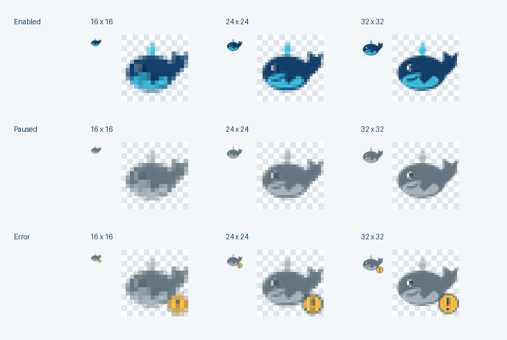

<p align="center">
  
</p>

<h1 align="center">🐳 WeType Audio Guard</h1>
<p align="center"><strong>微信输入法语音输入防静音 · 让其他应用的声音继续播放</strong></p>
<p align="center">A lightweight Windows utility to restore playback muted during WeType voice dictation.</p>

<p align="center">
  <a href="https://github.com/DearJIAN/WeType-Audio-Guard/releases/latest"></a>
  <a href="https://github.com/DearJIAN/WeType-Audio-Guard/actions/workflows/windows-release.yml"></a>
  <a href="LICENSE"></a>
  <a href="https://github.com/DearJIAN/WeType-Audio-Guard/releases"></a>
  
</p>

<p align="center">
  <a href="https://github.com/DearJIAN/WeType-Audio-Guard/releases/latest"><strong>⬇️ 下载 Windows 便携 EXE</strong></a>
  · <a href="CHANGELOG.md">更新日志</a>
  · <a href="docs/windows-tray-validation.md">Windows 验收记录</a>
</p>

## 项目简介

部分 Windows 电脑在使用微信输入法（WeType）语音转文字时，会把其他应用的**播放会话直接设为静音**，导致浏览器、视频、音乐或会议软件暂时没有声音。设置“Windows 通信 → 不执行任何操作”不一定能解决此问题。

**WeType Audio Guard 1.1** 在微信语音录入时监测播放静音变化，对录音前原本没有静音、随后被静音的会话尝试自动解除静音。它是**检测后恢复**，并不能阻止微信输入法最初修改静音状态，也不能保证所有 Windows 设备与软件兼容。

> **当前正式版本：1.1（Git tag `v1.1`）**。原 CLI 与修复后的托盘 EXE 均经过用户 Windows 实机防静音测试；1.1 修复了旧托盘版在恢复前反复扫描进程、造成约 2 秒/应用延迟的问题。Windows CI 已完成 46 项自动测试，部分长期/特殊设备场景仍待验证。

## 功能

- 🐳 **原创鲸鱼托盘图标**：蓝鲸代表已启用，灰鲸代表暂停，异常时有错误提示。
- 🔊 **及时恢复多应用声音**：去除录音期间逐个应用的耗时进程冲突扫描。
- ✅ **启动即开启保护**：双击 EXE 后自动请求启用，先等待安全基线建立；可随时暂停、重新启用或退出。
- 🎙️ **微信录音状态感知**：通过活动录音会话中的 `wetype_update.exe` 识别录音。
- 🛡️ **谨慎恢复**：仅针对事先未静音的已知会话；每次录音的每个会话最多尝试一次。
- 📝 **本地日志**：右键菜单「查看日志」用记事本显示近期记录，「复制日志」复制到剪贴板；不会自动上传。
- 📦 **Windows x64 单文件 EXE**：无需安装 Python / Conda，无安装器、开机自启或自动更新。

## 下载与使用

系统：**Windows 10 / 11 x64**。从 [GitHub Releases](https://github.com/DearJIAN/WeType-Audio-Guard/releases/latest) 下载：

- **`WeTypeAudioGuard.exe`**：直接运行的便携程序。
- **`WeTypeAudioGuard-1.1-windows-x64.zip`**：包含相同 EXE、README、变更记录及许可证原文。

1. 退出旧版鲸鱼托盘，并停止旧 CLI `python wetype_audio_guard.py --protect`，避免两个程序同时修改静音。
2. 双击 `WeTypeAudioGuard.exe`。通知区域会出现小鲸鱼（可能藏在折叠图标中）。**程序自动请求开启保护，无需手动点「启用保护」。**
3. 等待保护状态显示已开启并建立稳定空闲基线。随后播放视频，再开始微信输入法语音录入，观察声音是否继续正常播放。
4. 右键图标可查看带勾选标识的状态及累计恢复次数；也可以「暂停保护」「启用保护」「查看日志」「复制日志」「退出」。

**自动启用 ≠ Windows 开机自启。** 程序不会自行添加开机启动项，也不会修改系统服务。只要程序在运行、保护未暂停且未发生故障，就会持续监测，**没有运行总时限**；每次新录音前 2 秒的恢复窗口是每轮独立计算的。

**声音与隐私提示**：它只可能解除符合条件的播放静音，不修改麦克风静音或全局音量数值。由于无法区分同一恢复窗口内的用户主动静音与微信自动静音，可能误解除静音；请在普通视频场景完成首次测试，正式会议中谨慎使用外放。当前 EXE 没有代码签名，可能被 Windows SmartScreen 提示未知发布者；请仅从官方仓库下载，不要为此关闭安全软件。

日志位于 `%LOCALAPPDATA%\WeTypeAudioGuard\logs`，包含轮询状态、恢复次数及脱敏诊断信息；不采集语音/会议内容，也没有自动遥测。用户主动分享日志前应检查其内容。

## 技术机制与限制

通过 Windows Core Audio / WASAPI 识别 `wetype_update.exe` 的活跃捕获会话，并在**未录音的稳定状态**下学习输出会话的静音基线。录音开始后的短窗口内，仅对原本未静音而随后被静音的既有播放会话尝试 `SetMute(0, None)`。

- 对同一轮录音的同一个播放会话最多恢复一次；如果同轮被再次静音，当前策略不无限重试。
- 无法证明是谁下达了最初的静音指令；音频设备插拔、其他驱动与所有 Windows 软件兼容性尚未全面验证。
- 托盘使用专属音频子进程与 COM 所属线程，单实例互斥，并在启动启用阶段保守检测 CLI 保护冲突；并非严格的双向强互斥。
- 连续监测不等于无条件修改静音：暂停、错误、未知基线等情况下不会冒然解除静音。
- 1.1 的关键修复和真实 Windows 证据见 [Windows 验收与排障](docs/windows-tray-validation.md)。

## 从源码运行与打包

从克隆仓库开始：

```powershell
git clone https://github.com/DearJIAN/WeType-Audio-Guard.git
cd WeType-Audio-Guard
python -m pip install -r requirements-tray.txt
python .\wetype_audio_tray.py
```

保留原 CLI，用于诊断或独立保护（**不要与托盘并行保护**）：

```powershell
python -m pip install -r requirements.txt
python .\wetype_audio_guard.py --self-test
python .\wetype_audio_guard.py --diagnose
python .\wetype_audio_guard.py --protect
```

Windows 本地打包：

```powershell
python -m pip install -r requirements-build.txt
python tools\build_windows_exe.py
```

生成位置为 `dist\WeTypeAudioGuard.exe`。推荐使用官方 CPython 3.12 的独立构建环境；不同 Python/Conda 环境打包时可能遇到 `_ctypes` DLL 依赖问题。对外 EXE 由 GitHub Actions Windows runner 统一构建，并执行完整的单测、CLI 自测、冻结导入测试、模拟托盘/子进程验收及 SHA-256 一致性校验。上述自动测试不操作真实音频硬件。

## 🐋 为什么是鲸鱼？

因为项目作者的美丽未婚妻「**鲸鲸**」是一只喜欢深海蓝的小鲸鱼。💙

这只音频守护小鲸鱼由我们共同构思：**鲸鲸提出形象与配色创意，图标使用原创 Pillow 绘制代码实现**。愿它安静地待在你的任务栏，守护那些不该突然消失的声音。

## 致谢与许可证

感谢 [SDS-CC / WeType Voice Tip](https://github.com/SDS-CC/wetype-voice-tip)（MIT，© 2026 CYCYC-SDS）分享通过 WASAPI 监测 `wetype_update.exe` 录音会话的技术思路。本项目独立实现播放会话的防静音功能，未复制上游特有代码、图标或提示音，并非微信输入法官方产品。

自主编写的项目源码采用 **[MIT License](LICENSE)**（© 2026 DearJIAN）。第三方依赖使用各自许可证（例如 pystray 的 LGPLv3），见 [第三方许可声明](THIRD_PARTY_NOTICES.md) 及 [许可证原文](licenses/)。

[版本变更](CHANGELOG.md) · [问题反馈](https://github.com/DearJIAN/WeType-Audio-Guard/issues) · [正式下载](https://github.com/DearJIAN/WeType-Audio-Guard/releases)
